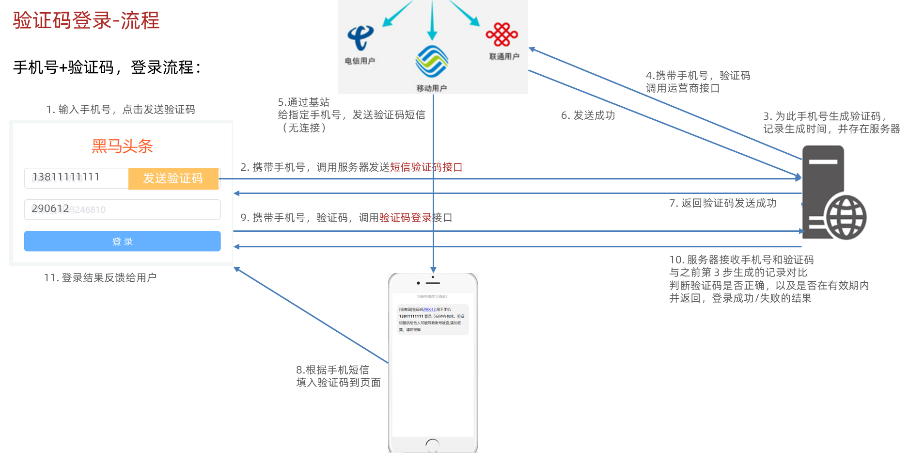

## Ajax&Node&Webpack&Git
<hr>

## Ajax
- 什么是 AJAX 
  - 使用浏览器的 XMLHttpRequest 对象 与服务器通信
  - 浏览器网页中，使用 AJAX技术（XHR对象）发起获取省份列表数据的请求，服务器代码响应准备好的省份列表数据给前端，前端拿到数据数组以后，展示到网页

- URL 
  - 格式：`协议://域名/资源路径`
  - 统一资源定位符(URL)，简称网址，用于定位网络中的资源（资源指的是：网页，图片，数据，视频，音频等等）
  -  协议
    - http 协议：超文本传输协议，规定了浏览器和服务器传递数据的格式
  -  域名：用于标记服务器在互联网当中的方位
  -  资源路径：用于标识你要访问的资源具体的位置
  -  查询参数
     - 携带给服务器额外信息，让服务器返回需要的数据
     - 语法：协议://域名/资源路径`?拼接格式（参数名=值1&参数名2=值2)`
     - axios携带查询参数
     ```javascript
        axios({
            url:'xxx',
            params:{
                参数名:值
            }
        }).then(result=>{
        
        });
     ```
- 常用请求方法 GET/PST/PUT/DELETE/PATCH
  - 提交数据 POST
    ```javascript
        axios({
           url: '目标资源地址',
           method: 'post',
           data: {
            参数名: 值
           }
        }).then(result => {
           //对服务器返回的数据做后续处理
        })
    ```
- HTTP协议 
  - 请求报文：浏览器按照协议规定发送给服务器的内容,可以快速确认我们发送的内容是否正确
    - 组成：请求行、请求头、请求体
      - 请求行：请求方法，URL，协议
      - 请求头：以键值对的格式携带的附加信息，比如：Content-Type（指定了本次传递的内容类型）
      - 空行：分割请求头，空行之后的是发送给服务器的资源
      - 请求体：发送的资源
  - 响应报文：服务器按照协议固定的格式，返回给浏览器的内容
    - 组成：响应行、响应头、响应体
      - 响应行（状态行）：协议，HTTP响应状态码，状态信息
        - HTTP 响应状态码
      - 响应头：以键值对的格式携带的附加信息，比如：Content-Type（告诉浏览器，本次返回的内容类型）
      - 空行：分割响应头，控制之后的是服务器返回的资源
      - 响应体：返回的资源
      

- bootstrap 弹框
  - Bootstrap 弹框：不离开当前页面，显示单独内容，供用户操作
    - 如何使用？
      - 属性控制方式
      1. 先引入 bootstrap.css 和 bootstrap.js 到自己网页中
      2. 准备弹框标签，确认结构（可以从 Bootstrap 官方文档的 Modal 里复制基础例子）- 运行到网页后，逐一对应标签和弹框每个部分对应关系
      3. 通过自定义属性，通知弹框的显示和隐藏，语法如下：
      ```html
      <!-- data-bs-toggle 用于定义组件的行为，指示组件在何时触发
      data-bs-target 指定需要被更改的HTML元素
      data-bs-target 属性与 data-bs-toggle 属性一起使用，用于将组件行为与目标元素关联起来
      具体使用方法见https://www.runoob.com/bootstrap5/bootstrap5-collapse.html-->
      <button data-bs-toggle="modal" data-bs-target="css选择器">
           显示弹框
      </button>
      <button data-bs-dismiss="modal">Close</button>
      ```
      
      - js控制方式
        - 在显示和隐藏之前，需要执行 JS 代码逻辑，就使用 JS 方式 控制 Bootstrap 弹框显示和隐藏，语法如下：

         ```js
         // 创建弹框对象
         const modalDom = document.querySelector('css选择器')
         const modal = new bootstrap.Modal(modelDom)
         
         // 显示弹框
         modal.show()
         // 隐藏弹框
         modal.hide()
         ```
        
- bootstrap toast提示框
  - bootstrap 的 toast 提示框和 modal 弹框使用很像，语法如下：
    1. 先准备对应的标签结构（模板里已有）
    2. 设置延迟自动消失的时间
    ```html
     <div class="toast" data-bs-delay="1500">
       提示框内容
     </div>
     ```
     3. 使用 JS 的方式，在 axios 请求响应成功时，展示结果
     ```js
     // 创建提示框对象
     const toastDom = document.querySelector('css选择器')
     const toast = new bootstrap.Toast(toastDom)
     // 显示提示框
     toast.show()
     ```
    
- XMLHttpRequest
  - AJAX 是浏览器与服务器通信的技术，采用 XMLHttpRequest 对象相关代码
  - axios 是对 XHR 相关代码进行了封装，让我们只关心传递的接口参数
  - 学习 XHR 可了解 axios 内部与服务器交互过程的真正原理
  - 语法：
  ```js
  const xhr = new XMLHttpRequest()
  xhr.open('请求方法', '请求url网址')
  xhr.addEventListener('loadend', () => {
    // 响应结果
    console.log(xhr.response)
  })
  xhr.send()
  ```
  - 单个查询参数：在 `url? `后面按照指定格式拼接参数名和值
  - 多个查询参数：用` URLSearchParams `把参数对象转成“参数名=值&参数名=值“格式的字符串，语法如下：
   ```js
   // 1. 创建 URLSearchParams 对象
   const paramsObj = new URLSearchParams({
     参数名1: 值1,
     参数名2: 值2
   })
   
   // 2. 生成指定格式查询参数字符串
   const queryString = paramsObj.toString()
   // 结果：参数名1=值1&参数名2=值2
   ```
  - 使用原生 XHR 进行数据提交的方式
    - 设置请求头 Content-Type：application/json，来告诉服务器端，我们发过去的内容类型是 JSON 字符串，让他转成对应数据结构取值使用
    - 传递的请求体数据：需要将JS对象转换成JSON字符串
    - 语法：
  ```js
      const xhr = new XMLHttpRequest()
      xhr.open('请求方法', '请求url网址')
      xhr.addEventListener('loadend', () => {
        console.log(xhr.response)
      })
      
      // 1. 告诉服务器，我传递的内容类型，是 JSON 字符串
      xhr.setRequestHeader('Content-Type', 'application/json')
      // 2. 准备数据并转成 JSON 字符串
      const user = { username: 'itheima007', password: '7654321' }
      const userStr = JSON.stringify(user)
      // 3. 发送请求体数据
      xhr.send(userStr)
  ```
  - Promise对象
    - Promise 对象：用于表示一个异步操作的最终完成（或失败）及其结构值
    - 优点：
      1. 逻辑更清晰（成功或失败会关联后续的处理函数）
      2. 了解 axios 函数内部运作的机制
      3. 能解决回调函数地狱问题
    - 基本语法：
  ```js
  // 1. 创建 Promise 对象
  const p = new Promise((resolve, reject) => {
  // 2. 执行异步任务-并传递结果
  // 成功调用: resolve(值) 触发 then() 执行
  // 失败调用: reject(值) 触发 catch() 执行
  })
  // 3. 接收结果
  p.then(result => {
  // 成功
  }).catch(error => {
  // 失败
  })
   ```
    - Promise状态
      - 三种状态
        1. 待定（pending）：初始状态，既没有被兑现，也没有被拒绝
        2. 已兑现（fulfilled）：操作成功完成
        3. 已拒绝（rejected）：操作失败
      - 状态改变：调用对应函数，改变 Promise 对象状态后，内部触发对应回调函数传参并执行
      - 一旦被兑现/拒绝敲定，无法改变状态
     

- AJAX进阶
  - 同步代码和异步代码
    - 同步代码：逐行执行，需原地等待结果后，才继续向下执行
    - 异步代码：调用后耗时，不阻塞代码继续执行（不必原地等待），在将来完成后触发回调函数传递结果
      - JS中的异步代码
        - 定时器：setTimeout/setInterval
        - 事件监听
        - AJAX网络请求
      - 依靠回调函数来接收
      
  - 回调函数地狱
    - 概念：在回调函数中嵌套回调函数，一直嵌套下去就形成了回调函数地狱
    - 缺点：可读性差，异常无法捕获，耦合性严重，牵一发动全身
    
  - Promise-链式调用
    - 概念：依靠 then() 方法会返回一个新生成的 Promise 对象特性，继续串联下一环任务，直到结束
    - 细节：then() 回调函数中的返回值，会影响新生成的 Promise 对象最终状态和结果
    - 好处：通过链式调用，解决回调函数嵌套问题

  - async、await
    - 在 async 函数内，使用 await 关键字取代 then 函数，等待获取 Promise 对象成功状态的结果值
    - await必须用在async修饰的函数内（await会阻止"异步函数内"代码继续执行，原地等待结果）
    - 可用try...catch...代码块捕获异常

  - 事件循环
    - JavaScript 单线程（某一刻只能执行一行代码），为了让耗时代码不阻塞其他代码运行，设计了事件循环模型
    - 事件循环负责执行代码，收集和处理事件以及执行队列中的子任务
    - 执行代码和收集异步任务的模型，在调用栈空闲，反复调用任务队列里回调函数的执行机制，就叫事件循环
    - 宏任务与微任务：
      - 宏任务：由浏览器环境执行的异步代码
        - 种类：JS脚本执行事件、定时器函数、Ajax请求完成事件、用户交互事件
      - 微任务：由 JS 引擎环境执行的异步代码
        - 种类：Promise对象.then()的回调函数
      - 执行顺序：先执行完`全部微任务队列里的回调函数`，再执行`宏任务队列里的回调函数`

- 补充
1. axios 请求基地址
- 语法
```js
  axios.defaults.baseURL = URL公共前缀地址
```

2. 验证码登录
- 流程图


  3. axios拦截器
     1. 请求拦截器：发起请求之前，触发的配置函数，对请求参数进行额外配置
      ```js
      //模版
      axios.interceptors.request.use(function (config) {
        // 在发送请求之前做些什么
        return config
      }, function (error) {
        // 对请求错误做些什么
        return Promise.reject(error)
      })
      ```

     2. 响应拦截器：响应回到 then/catch 之前，触发的拦截函数，对响应结果统一处理
   
     ``` js 
     //模版
     axios.interceptors.response.use(function (response) {
       // 2xx 范围内的状态码都会触发该函数。
       return result;
     }, function (error) {
       // 超出 2xx 范围的状态码都会触发该函数。
       // 对响应错误做点什么，例如：判断响应状态为 401 代表身份验证失败
       return Promise.reject(error);
     });
     ```
     e.g.
     ```js
     //对正常的响应状态码（2xx)进行数据处理
     //若HTTP响应状态码为401（未认证）,则清除其token，并强制退出登录
     axios.interceptors.response.use(function (response) {
      // 2xx 范围内的状态码都会触发该函数。
        const result = response.data
        return result;
      }, function (error) {
      // 超出 2xx 范围的状态码都会触发该函数。
      // 对响应错误做点什么，例如：判断响应状态为 401 代表身份验证失败
        if (error?.response?.status === 401) {
          alert('登录状态过期，请重新登录')
          window.location.href = '../login/index.html'
        }
        return Promise.reject(error);
     });
     ```
  

4. 富文本编辑器插件 --- wangEditor
- 官方文档：https://www.wangeditor.com/v5/getting-started.html
- 导入( version:5.1.23 )
  1. 引入css和js文件
  ```html
  <!-- css文件 -->
  <link href="https://cdn.jsdelivr.net/npm/@wangeditor/editor@5.1.23/dist/css/style.min.css" rel="stylesheet">
  
  <!-- js文件 -->
  <script src="https://cdn.jsdelivr.net/npm/@wangeditor/editor@5.1.23/dist/index.min.js"></script>
  ```
  
  2. 定义 HTML 结构
  ```html
  <!--html结构-->
  <div id="editor—wrapper">
    <div id="toolbar-container"><!-- 工具栏 --></div>
    <div id="editor-container"><!-- 编辑器 --></div>
  </div>
  ```
  
  3. 引入css样式
  ```css
    #editor—wrapper {
      border: 1px solid #ccc;
      z-index: 100; /* 按需定义 */
    }
    #toolbar-container {
      border-bottom: 1px solid #ccc;
    }
    #editor-container {
      height: 500px;
    }
  ```
  
  4. 引入 JS 创建编辑器
  ```js
  const { createEditor, createToolbar } = window.wangEditor
  const editorConfig = {
    placeholder: 'Type here...',
    onChange(editor) {
      const html = editor.getHtml()
      console.log('editor content', html)
      // 也可以同步到 <textarea>
    },
  }
  const editor = createEditor({
    selector: '#editor-container',
    html: '<p><br></p>',
    config: editorConfig,
    mode: 'default', // or 'simple'
  })
  const toolbarConfig = {}
  const toolbar = createToolbar({
    editor,
    selector: '#toolbar-container',
    config: toolbarConfig,
    mode: 'default', // or 'simple'
  })
  ```
  
5. 页面跳转传参（URL 查询参数方式）
- 方法：将要传到跳转厚的页面的参数写在URL的查询参数中，随页面跳转传递所需参数
