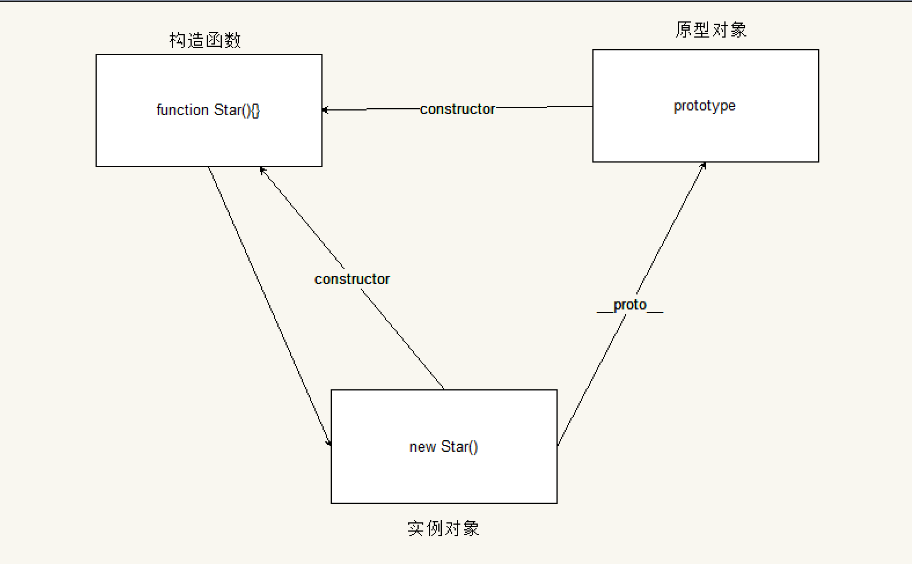
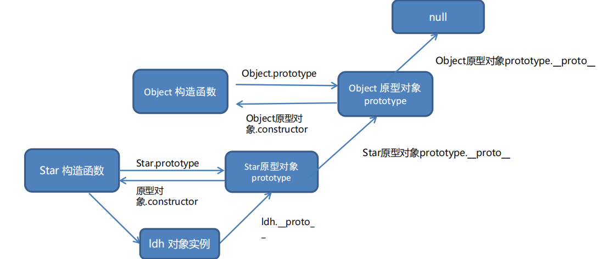

## js进阶

<hr>
### 作用域

- 局部作用域
  - 函数作用域
  - 块作用域
    - var声明的变量不产生块作用域
    - let、const声明的变量有块作用域
    - 不同代码块之间的变量无法互相访问

- 全局作用域
  - `<script>` 标签和 `.js` 文件的`最外层`就是所谓的全局作用域，在此声明的变量在函数内部也可以被访问。
  - 全局作用域中声明的变量，任何其它作用域都可以被访问
  - 为 `window` 对象动态添加的属性默认也是全局的，不推荐！
  - 函数中`未使用任何关键字`声明的变量为全局变量.不推荐!!!
  - 尽可能少的声明全局变量，防止全局变量被污染

- 作用域链
  - 本质：底层的变量查找机制
  - 在函数被执行时，会优先查找`当前函数作用域`中查找变量，如果当前作用域查找不到则会依次逐级查找`父级作用域`直到`全局作用域`
  - 嵌套关系的作用域串联起来形成了作用域链
  - 相同作用域链中按着`从小到大`的规则查找变量
  - **子作用域能够访问父作用域，父级作用域无法访问子级作用域**

- 垃圾回收机制
  - 引用计数法
  - 标记清除法

- JS闭包
  - 闭包 = 内层函数 + 外层函数的变量
  - 常见格式：

  ```javascript
    function outer() {
        let a=10;
        function fn() {
            console.log(a);
        }
        return fn;
    }
    outer();
  ```

  - 作用
    - 封闭数据，实现数据私有，外部也可以访问函数内部的变量
    - 闭包很有用，因为它允许将函数与其所操作的某些数据（环境）关联起来
  - 可能引起内存泄漏

- 变量提升(仅针对var声明的变量！！！)
  1. `let`变量在未声明即被访问时会报语法错误
  2. `var`变量在声明之前即被访问，变量的值为 `undefined`
  3. `let` 声明的变量不存在变量提升，推荐使用 `let`
  4. `var`变量提升出现在相同作用域当中
  5. 实际开发中推荐先声明再访问变量

### 函数进阶

- 函数提升
  - 函数提升能够使函数的声明调用更灵活
  - 函数表达式不存在提升的现象
  - 函数提升出现在相同作用域当中

- 函数参数
  - 默认值
  - 动态参数
    - arguments 伪数组
      - `arguments` 是函数内部内置的伪数组变量，它包含了调用函数时传入的所有实参。
  - 剩余参数 a,b(,参数名),...数组名
    1. `...` 是语法符号，置于最末函数形参之前，用于获取多余的实参
    2. 借助 `...` 获取的剩余实参，是个真数组
    3. 展开运算符 ...数组名
       - 求数组最大/小值：Math.max/min(...数组名)

### 面向对象

- 构造函数

- 原型对象 prototype
  - JavaScript 规定，每一个构造函数都有一个 prototype 属性，指向另一个对象，所以我们也称为原型对象
  - 这个对象可以挂载函数，对象实例化不会多次创建原型上函数，节约内存
  - 我们可以把那些不变的方法，直接定义在 prototype 对象上，这样所有对象的实例就可以共享这些方法。
  - 构造函数和原型对象中的this 都指向 实例化的对象

- constructor 属性
  - 该属性指向该原型对象的构造函数
  - 使用场景
    - 如果有多个对象的方法，可给原型对象采取对象形式赋值，但会覆盖构造函数原型对象原来的内容，这样修改后的原型对象 constructor 就`不再指向当前构造函数`，此时可以在修改后的原型对象中`添加一个 constructor 指向原来的构造函数`！！

- 对象原型 &nbsp;**proto** (只读！！！)
  - 对象都会有一个属性 **proto** 指向构造函数的 prototype 原型对象，之所以我们对象可以使用构造函数 prototype
  - __proto__对象原型里面也有一个 constructor属性，指向创建该实例对象的构造函数



- 原型继承
  - 子类.prototype =  new 父类()

- 原型链
  - 基于原型对象的继承使得不同构造函数的原型对象关联在一起，并且这种关联的关系是一种链状的结构，我们将原型对象的链状结构关系称为`原型链`
  - 当访问一个对象的属性（包括方法）时，首先查找这个对象自身有没有该属性。 如果没有就查找它的原型（也就是
  - __proto__指向的 prototype 原型对象） 如果还没有就查找原型对象的原型（Object的原型对象）。依此类推一直找到 Object 为止（null）。
  - __proto__对象原型的意义就在于为对象成员查找机制提供一个方向，或者说一条路线


### 高阶技巧

- 深浅拷贝
  - 浅拷贝和深拷贝只针对引用类型，简单数据类型深浅拷贝无差异
  - 浅拷贝
    - 拷贝的是地址
    - 常见方法：
      - 拷贝对象：Object.assgin() / 展开运算符 {...obj} 拷贝对象
      - 拷贝数组：Array.prototype.concat() 或者 [...arr]
      - 潜在风险：简单数据类型拷贝值，引用数据类型拷贝的是地址 (单层不包含数组或对象的对象可以使用以上方法，但若含有数组或对象的多层对象不能使用以上方法）

  - 深拷贝
    - 拷贝的是`对象`，不是地址
    - 常见方法：
      - 通过递归实现深拷贝

      ```javascript
        //递归实现
        function deepCopy(oldObj,newObj){
            for (let key in oldObj) {
                //一定要先拷贝数组再拷贝对象，否则数组会直接被当成对象进行处理！！！
                if (oldObj[key] instanceof Array){
                    newObj[key] = [];
                    deepCopy(oldObj[key],newObj[key]);
                } else if (oldObj[key] instanceof Object){
                    newObj[key] = {};
                    deepCopy(oldObj[key],newObj[key]);
                } else {newObj[key]=oldObj[key];}
            }
            return newObj;
        }
  
        const obj = {
            uname:'pink',
            age:20,
            hobby:['sport','watch TV'],
            family:{
                brother:'Little Pink'
            }
        }
        const o = {};
        deepCopy(obj, o);
        console.log(o);
      ```

    - lodash库：_.cloneDeep(obj)

    ```html
        <body>
            <script src="lodash.min.js"></script>
            <script>
                //obj与前面相同
                const obj = {
                    uname:'pink',
                    age:20,
                    hobby:['sport','watch TV'],
                    family:{
                        brother:'Little Pink'
                    }
                };
                const o = _.cloneDeep(obj);
                o.family.brother = 'KEVIN CHAN'
                console.log(obj,o);
            </script>
        </body>
    ```

    - 通过JSON.stringify()实现

    ```html
    <body>
        <script>
            const obj = {
               uname:'pink',
               age:20,
               hobby:['sport','watch TV'],
               family:{
                  brother:'Little Pink'
               }                    
            };
            /*用stringify将对象转换为JSON字符串，再用parse重新转换
            成新的对象，转换后对象的值相同但已不是同一对象*/
            const o = JSON.parse(JSON.stringify(obj));
            o.family.brother = 'KEVIN CHAN'
            console.log(obj,o);
        </script>
    </body>
    ```

- 异常处理
  - throw抛异常
    - `throw` 抛出异常信息，程序也会终止执行
    - `throw` 后面跟的是错误提示信息
    - `Error` 对象配合 `throw` 使用，能够设置更详细的错误信息
  
  - try catch fianlly 捕获异常
    - `try...catch` 用于捕获错误信息
    - 将预估可能发生错误的代码写在 `try` 代码段中
    - 如果 `try` 代码段中出现错误后，会执行 `catch` 代码段，并截获到错误信息

- 处理this
  - **普通函数**:
    - 调用方式决定了 `this` 的值，即【谁调用 `this` 的值指向谁】
    - 普通函数没有明确调用者时 `this` 值为 `window`，严格模式下没有调用者时 `this` 的值为 `undefined`。
  - **箭头函数**
    - 箭头函数中并不存在 `this`！！！
    - 箭头函数中访问的 `this` 是箭头函数所在作用域的 `this` 变量。（若所在作用域无this，则`继续向上寻找直到this有定义`。如无法找到，则this的值为`undefined`
    - 在开发中【使用箭头函数前需要考虑函数中 `this` 的值】，**事件回调函数**使用箭头函数时，`this` 为全局的 `window`，因此DOM事件回调函数不推荐使用箭头函数！！！
    - 基于原型的面向对象不推荐采用箭头函数！！！
    - 在本级作用域需要使用上级作用域可使用this

  - 改变this指向
    - call(thisArg,agr1,arg2,...)
    - apply(thisArg,argsArray)
    - bind(thisArg[,arg1,arg2,...]) 不会立即调用，但可以改变this值

    - 相同点：都可以改变函数内部的 this 指向
    - 不同点
      - call 和 apply 会调用函数 , 并且改变函数内部 this 指向
      - call 和 apply 传递的参数不一样 , call 传递参数 aru1, aru2.. 形式 apply 必须数组形式 arg
      - bind 不会调用函数 , 可以改变函数内部 this 指向
    - 主要应用场景
      1. call 调用函数并且可以传递参数
      2. apply 经常跟数组有关系 . 比如借助于数学对象实现数组最大值最小值
      3. bind 不调用函数 但是还想改变 this 指向 . 比如改变定时器内部的 this 指向
