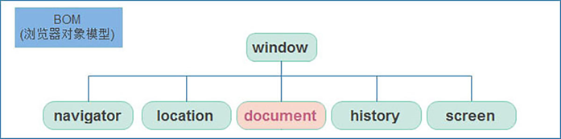

1. **变量声明**：**const**优先，如需修改用**let**，从不考虑**var**
2. 引用数据类型在栈里以地址的方式进行存储，即使用const修饰也可修改里面的值，但不能修改地址。
3. WebAPI
- 分类：DOM(文档对象模型)、BOM(浏览器对象模型)
- DOM树
  - 将HTML文档以树状结构直观的表现出来，体现标签之间的关系
- DOM对象：浏览器根据HTML标签生成的js对象
  - document对象
    - DOM提供的一个对象，所有内容都在document里
    - 用来访问和操作网页内容
  
- 获取DOM对象
  - 根据css选择器获取
    - 1.选择匹配的第一个元素
      - document.querySelector()

- 回车键(Enter)触发form表单提交问题
  - 触发条件:
  1. 如果表单里有一个type=”submit”的按钮，回车键生效。
  2. 如果表单里只有一个type=”text”的input，不管按钮是什么type，回车键生效。
  3. 如果按钮不是用input，而是用button，并且没有加type，IE下默认为type=button，FX默认为type=submit。
  4. 其他表单元素如textarea、select不影响，radio checkbox不影响触发规则，但本身在FX下会响应回车键，在IE下不响应。
  5. type=”image”的input，效果等同于type=”submit”，不知道为什么会设计这样一种type，不推荐使用，应该用CSS添加背景图合适些。
  - 解决方案
  1. 表单响应回车键：保证表单里有个type=”submit”的按钮就行。
  2.  不响应回车键：
    - 写一个无意义的文本框，隐藏起来。
    - 根据第3条规则，我们在用button的时候，尽量显式声明type以使浏览器表现一致。
    - 判断按下的键是否为回车键

  - window对象
    
    - **BOM** (Browser Object Model ) 是浏览器对象模型

    - window对象是一个全局对象，也可以说是JavaScript中的顶级对象
    - 像document、alert()、console.log()这些都是window的属性，基本BOM的属性和方法都是window的
    - 所有通过var定义在全局作用域中的变量、函数都会变成window对象的属性和方法
    - window对象下的属性和方法调用的时候可以省略window
  
  - 定时器-延迟函数 setTimeout
    - setTimeout 仅仅只执行一次，所以可以理解为就是把一段代码延迟执行, 平时省略window
    - 延时函数需要等待,所以后面的代码先执行
    - 返回值是一个正整数，表示定时器的编号
    - 每一次调用延时器会产生一个新的延时器
  